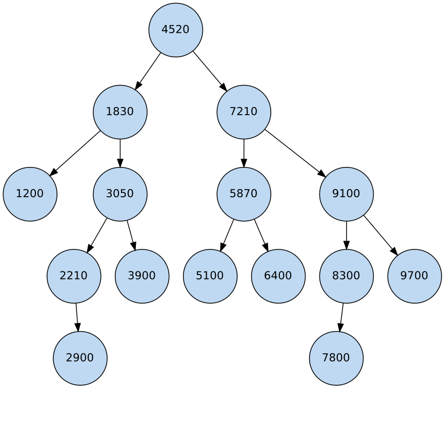
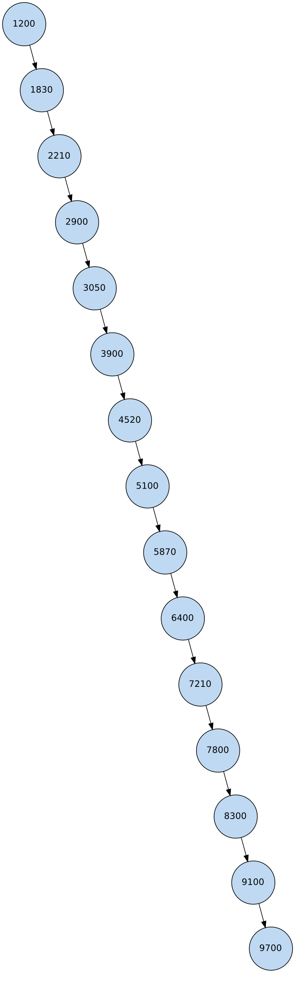
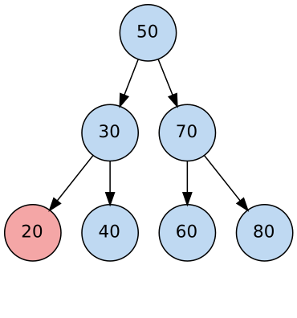
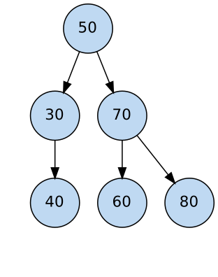
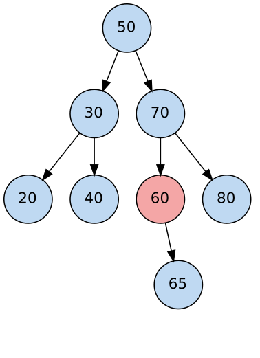
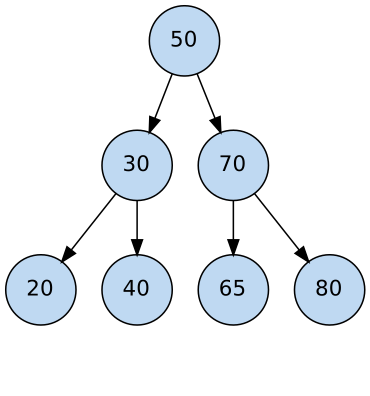
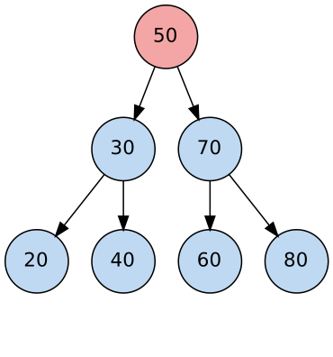
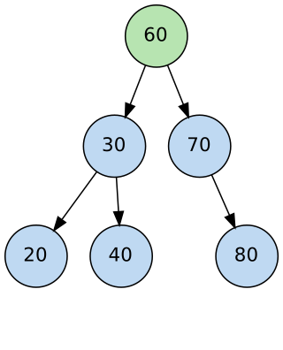

# Estructura de Datos II – BST: inserción, búsqueda y eliminación (Guías 4 y 5)

**Reto 1 – "Catálogo inteligente":** BST de códigos de producto con inserción y búsqueda recursivas, probado con datos ordenados y aleatorios.
**Reto 2 – "Eliminar sin destruir el árbol":** método `eliminar()` con los tres casos, con diagramas antes/después.

## Estructura
```
src/NodoArbol.java   nodo genérico (dato, izquierdo, derecho)
src/ArbolBST.java    insertar, buscar, altura, eliminar, minValor, recorridos
src/Main.java        pruebas de ambos retos
salida.txt           salida real de la ejecución
diagramas/           árboles aleatorio/ordenado y antes/después de cada eliminación
```
Compilar y ejecutar: `cd src && javac *.java && java Main`

## Convención
Menores a la izquierda; mayores **o iguales** a la derecha (igual que el código base de la guía).

---
## Guía 4 – Inserción y búsqueda

`insertarRec` desciende comparando con cada nodo hasta hallar un `null` y allí crea el nodo. `buscarRec` sigue el mismo camino único y devuelve `true` si encuentra el valor o `false` al llegar a `null`. Se agregó un contador de comparaciones (cada nodo visitado = 1 comparación).

Datos de prueba (15 códigos): `4520, 1830, 7210, 3050, 9100, 2210, 5870, 6400, 1200, 8300, 3900, 7800, 2900, 5100, 9700`

| Aleatorio | Ordenado |
|---|---|
|  |  |

### Cinco búsquedas
| Código | Aleatorio | Comps. | Ordenado | Comps. |
|---|---|---|---|---|
| 5870 | encontrado | 3 | encontrado | 9 |
| 1200 | encontrado | 3 | encontrado | 1 |
| 9700 | encontrado | 4 | encontrado | 15 |
| 4000 | no encontrado | 4 | no encontrado | 7 |
| 9999 | no encontrado | 4 | no encontrado | 15 |

Ejemplo de camino (buscar 5870): aleatorio `4520 → 7210 → 5870`; ordenado `1200 → 1830 → … → 5100 → 5870` (9 nodos).

### Tabla comparativa (n = 15)
| Inserción | Altura | Promedio de comparaciones (búsqueda exitosa) | Complejidad |
|---|---|---|---|
| Aleatoria | 5 | 3,40 | ≈ O(log n) |
| Ordenada | 15 | 8,00 | O(n) |

### Análisis O(log n) frente a O(n)
En cada nodo se descarta un subárbol completo, así que el costo es proporcional a la **altura**. Con datos aleatorios el árbol queda razonablemente balanceado (altura 5 ≈ log₂15 ≈ 3,9 más holgura): se hacen pocas comparaciones, ≈ O(log n). Con datos ya ordenados cada nuevo valor es mayor que todos los anteriores y se va siempre a la derecha: el árbol se degenera en una **lista enlazada** (altura 15 = n), y buscar el último elemento exige recorrer los n nodos, O(n). Con n = 15 el promedio sube de 3,4 a 8 comparaciones, y la diferencia crece con n (para n = 1.000.000, ~20 frente a ~500.000 en promedio). Conclusión: un BST sin balanceo pierde su eficiencia si los datos llegan ordenados; la solución son árboles autobalanceados (AVL, rojo-negro) o mezclar el orden de inserción.

---
## Guía 5 – Eliminación

`eliminarRec` busca el nodo igual que `buscarRec` y, al encontrarlo, distingue tres casos. La recursión reasigna `izquierdo`/`derecho` del padre con el valor que devuelve la llamada.

### Caso 1 – Hoja (eliminar 20)
El nodo no tiene hijos: se devuelve `null`, así que el **hijo izquierdo de 30 pasa a `null`**.

| Antes | Después |
|---|---|
|  |  |

### Caso 2 – Un hijo (eliminar 60, con hijo derecho 65)
Se devuelve el único hijo: el **hijo izquierdo de 70 pasa de 60 a 65**. El nodo 60 queda sin referencias y lo recoge el recolector de basura.

| Antes | Después |
|---|---|
|  |  |

### Caso 3 – Dos hijos (eliminar la raíz 50)
1. `minValor(nodo.getDerecho())` baja siempre a la izquierda del subárbol derecho → sucesor inorden = **60**.
2. Se copia 60 en el nodo (`setDato`).
3. Se elimina el 60 duplicado del subárbol derecho (que es hoja o tiene solo hijo derecho, por lo que cae en caso 1 o 2).

Cambia el **dato** del nodo y el **hijo derecho** (el subárbol sin el sucesor); el izquierdo no se toca.

| Antes | Después |
|---|---|
|  |  |

### Referencias que cambian (resumen)
| Caso | Qué cambia |
|---|---|
| Hoja | La referencia del padre al nodo pasa a `null` |
| Un hijo | La referencia del padre apunta al nieto (único hijo) |
| Dos hijos | Se reemplaza el dato por el sucesor inorden y se elimina el duplicado en el subárbol derecho |

### Pruebas
En `salida.txt`: los tres casos, un nodo interno con dos hijos (70), un valor inexistente (99, el árbol no cambia) y una prueba de robustez que elimina los 15 códigos uno a uno comprobando que el árbol sigue siendo un BST y que el valor ya no se encuentra (resultado: `true`).
