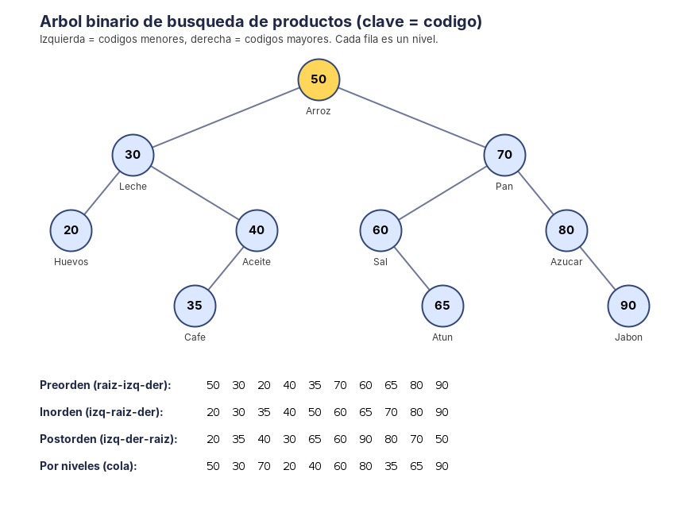

# Exploradores del árbol – Recorridos en un BST de productos

**Asignatura:** Estructura de Datos II · Ingeniería de Software / Sistemas · Semestre IV
**Lenguaje:** Java (JDK 11 o superior)
**Guía:** 6 – Recorridos en árboles binarios

## 1. Qué hace el programa

Construye un **árbol binario de búsqueda (BST)** de 10 productos, ordenado por **código**, y ejecuta sobre el mismo árbol los cuatro recorridos: **Preorden, Inorden, Postorden y por niveles**. Comprueba que Inorden devuelve los códigos ordenados.

Regla del BST: en cada nodo, los códigos del subárbol izquierdo son **menores** y los del derecho son **mayores**.

## 2. El árbol

Productos, en el orden en que se insertan: 50 Arroz, 30 Leche, 70 Pan, 20 Huevos, 40 Aceite, 60 Sal, 80 Azúcar, 35 Café, 65 Atún, 90 Jabón.



## 3. Tabla de los cuatro recorridos

| Recorrido | Orden de visita | Secuencia obtenida (códigos) |
|---|---|---|
| **Preorden** | raíz → izquierda → derecha | 50 30 20 40 35 70 60 65 80 90 |
| **Inorden** | izquierda → raíz → derecha | 20 30 35 40 50 60 65 70 80 90 |
| **Postorden** | izquierda → derecha → raíz | 20 35 40 30 65 60 90 80 70 50 |
| **Por niveles** | nivel 0, nivel 1, ... (cola) | 50 30 70 20 40 60 80 35 65 90 |

Por niveles, agrupado: nivel 0 = [50] · nivel 1 = [30, 70] · nivel 2 = [20, 40, 60, 80] · nivel 3 = [35, 65, 90].

## 4. Análisis: qué información produce cada recorrido

| Recorrido | Qué información da | Caso de uso apropiado |
|---|---|---|
| **Preorden** | La raíz de cada subárbol aparece **antes** que sus hijos. La secuencia empieza en 50, la raíz. | **Copiar o guardar el árbol**: si se reinsertan los códigos en este orden se obtiene exactamente el mismo BST (comprobado en las pruebas). |
| **Inorden** | En un BST, los códigos salen **de menor a mayor**: 20, 30, 35, ... 90. | **Listados ordenados** (catálogo por código), consultas por rango y encontrar el menor, el mayor o el k-ésimo elemento. |
| **Postorden** | Cada nodo aparece **después** de sus dos hijos. La secuencia termina en 50, la raíz. | **Eliminar o liberar el árbol**, y cálculos que necesitan los resultados de los hijos antes que el padre (totales, alturas, tamaños). |
| **Por niveles** | Muestra el árbol **capa por capa**, de arriba hacia abajo. Los nodos más cercanos a la raíz salen primero. | **Ver la forma del árbol**, calcular su altura (4 niveles) y problemas de "el más cercano a la raíz". |

### Comprobación: Inorden devuelve las claves ordenadas

| | Resultado |
|---|---|
| Inorden | 20, 30, 35, 40, 50, 60, 65, 70, 80, 90 |
| Lista de los códigos ordenada con `Collections.sort` | 20, 30, 35, 40, 50, 60, 65, 70, 80, 90 |
| ¿Iguales? | **Sí** |

**Por qué ocurre:** Inorden visita primero todo el subárbol izquierdo (códigos menores que la raíz), luego la raíz y al final el subárbol derecho (códigos mayores). Como esa regla se cumple en cada nodo, la secuencia completa queda ordenada.

### ¿Qué recorrido usaría para eliminar un árbol completo?

**Postorden.** Un nodo se libera solo **después de sus dos hijos**, así nunca se pierde la referencia a un subárbol que aún no se ha liberado. Con Preorden se soltaría el padre primero y los hijos podrían quedar inalcanzables. El método `vaciar()` lo implementa: libera en el orden 20, 35, 40, 30, 65, 60, 90, 80, 70, 50 y deja el árbol vacío.

### Cómo funciona el recorrido por niveles

Usa una **cola (Queue)**. Se agrega la raíz; mientras la cola no esté vacía, se saca un nodo, se visita y se agregan sus hijos izquierdo y derecho al final. Como la cola es FIFO, todos los nodos de un nivel salen antes que los del siguiente. Antes de procesar cada nivel se guarda `cola.size()`: esa cantidad es exactamente el número de nodos de ese nivel, y permite agrupar la salida por niveles.

## 5. Complejidad

| Recorrido | Tiempo | Memoria extra |
|---|---|---|
| Preorden, Inorden, Postorden | O(n): cada nodo se visita una vez | O(h) por la recursión (h = altura; en el peor caso, un árbol degenerado, h = n) |
| Por niveles | O(n) | O(w) por la cola (w = ancho máximo del árbol) |

## 6. Estructura del proyecto

```
exploradores-arbol/
├── Producto.java        # código (clave), nombre y precio, con validaciones
├── NodoArbol.java       # nodo genérico: dato + hijo izquierdo + hijo derecho
├── ArbolProductos.java  # BST: insertar, buscar, 4 recorridos, altura y vaciar()
├── DibujoArbol.java     # genera arbol.png con el árbol y las cuatro secuencias
├── Main.java            # construye el árbol, imprime los resultados y ejecuta 19 pruebas
├── arbol.png
├── salida.txt           # salida real de la ejecución
└── README.md
```

## 7. Pruebas (19, todas correctas)

- Las cuatro secuencias exactas del árbol de 10 productos.
- Inorden igual a la lista ordenada y estrictamente creciente.
- Preorden y por niveles empiezan en la raíz; Postorden termina en la raíz.
- Niveles con 1, 2, 4 y 3 nodos.
- Los cuatro recorridos visitan exactamente los mismos 10 nodos.
- Reinsertar el Preorden reconstruye el mismo árbol.
- Casos límite: árbol vacío, un solo nodo y árbol degenerado (1 a 5 en orden).
- Código repetido rechazado, producto inválido lanza excepción.
- **200 árboles aleatorios** (semilla fija): Inorden siempre coincide con un `TreeSet` ordenado.
- `vaciar()` libera en Postorden y deja el árbol vacío.

## 8. Compilar y ejecutar

```bash
javac -encoding UTF-8 -d out *.java
java -cp out Main
```

Genera `arbol.png` en la carpeta actual y termina con código de salida 0 si todas las pruebas pasan.

## 9. Entrega en GitHub

```bash
git init
git add .
git commit -m "Guía 6: recorridos en un BST de productos"
git branch -M main
git remote add origin https://github.com/<usuario>/06-recorridos.git
git push -u origin main
```
