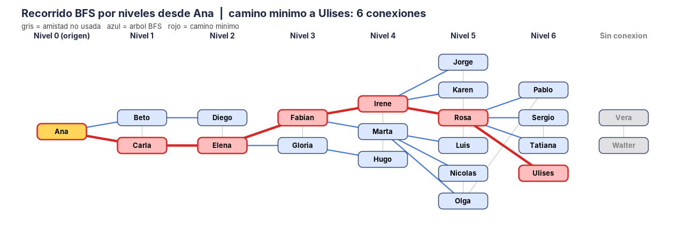

# Reto "Seis grados de separación" – BFS en una red social simulada

**Asignatura:** Estructura de Datos II · Ingeniería de Software / Sistemas · Semestre IV
**Lenguaje:** Java (JDK 11 o superior)
**Entregable:** programa Java con BFS + representación gráfica del recorrido + pruebas.

## 1. El problema

La teoría de los "seis grados de separación" dice que cualquier persona puede conectarse con otra a través de una cadena de, como máximo, seis conocidos. El reto es construir una red social simulada y usar **BFS** para calcular el **número mínimo de conexiones** entre dos usuarios, mostrando el recorrido **por niveles**.

## 2. Modelo (grafo)

| Elemento | Representación |
|---|---|
| Usuario | Vértice |
| Amistad | Arista **no dirigida** (si A es amigo de B, B es amigo de A) |
| Peso | Ninguno (grafo **no ponderado**: cada conexión cuenta 1) |
| Número mínimo de conexiones | Distancia más corta en aristas entre dos vértices |

La red simulada tiene **22 usuarios y 29 conexiones**, organizados en grupos (colegio, universidad, trabajo, barrio, gimnasio) unidos por "puentes". Además hay un grupo aislado (`Vera` – `Walter`) para probar el caso de dos usuarios sin ninguna cadena de amistades.

Se guarda con **lista de adyacencia** (`Map<String, Set<String>>`). Los amigos están en un `TreeSet`, así el recorrido es siempre alfabético y las pruebas son verificables.

## 3. ¿Por qué BFS?

BFS recorre el grafo **por niveles** con una **cola (FIFO)**: primero el origen (nivel 0), luego sus amigos (nivel 1), luego los amigos de sus amigos (nivel 2), etc. Como siempre visita primero lo más cercano, **la primera vez que llega a un usuario lo hace por un camino con el mínimo de conexiones**. DFS no garantiza esto: puede llegar por un camino larguísimo.

### Pseudocódigo

```
BFS(origen):
    distancia[origen] = 0;  cola.agregar(origen)
    mientras cola no esté vacía:
        n = tamaño de la cola              // usuarios del nivel actual
        repetir n veces:
            u = cola.sacar()
            para cada amigo v de u:
                si v no tiene distancia:
                    distancia[v] = distancia[u] + 1
                    padre[v] = u
                    cola.agregar(v)
```

- **Niveles:** cada vuelta del `mientras` procesa exactamente un nivel.
- **Camino mínimo:** se reconstruye siguiendo `padre` desde el destino hasta el origen y se invierte.
- **Complejidad:** O(U + C) en tiempo (cada usuario y cada conexión se visitan una vez) y O(U) en memoria extra.

## 4. Estructura del proyecto

```
seis-grados/
├── RedSocial.java          # Grafo + BFS por niveles, distancia, camino mínimo, diámetro
├── GraficoRecorrido.java   # Dibuja el recorrido por niveles en un PNG (Java2D)
├── Main.java               # Construye la red, muestra resultados y ejecuta 19 pruebas
├── recorrido_Ana_Ulises.png
├── recorrido_Hugo_Beto.png
├── salida.txt              # Salida real de la ejecución
└── README.md
```

## 5. Cómo compilar y ejecutar

```bash
javac -encoding UTF-8 -d out *.java
java -cp out Main
```

Genera en la carpeta actual los dos PNG del recorrido y termina con código de salida 0 si todas las pruebas pasan.

## 6. Resultados

### Recorrido por niveles desde Ana

| Nivel | Usuarios |
|---|---|
| 0 | Ana |
| 1 | Beto, Carla |
| 2 | Diego, Elena |
| 3 | Fabian, Gloria |
| 4 | Irene, Marta, Hugo |
| 5 | Jorge, Karen, Rosa, Luis, Nicolas, Olga |
| 6 | Pablo, Sergio, Tatiana, Ulises |

Desde Ana se alcanzan 20 de los 22 usuarios (faltan `Vera` y `Walter`).

### Caminos mínimos

| Origen → Destino | Conexiones | Camino |
|---|---|---|
| Ana → Ulises | 6 | Ana – Carla – Elena – Fabian – Irene – Rosa – Ulises |
| Ana → Hugo | 4 | Ana – Carla – Elena – Gloria – Hugo |
| Beto → Rosa | 5 | Beto – Carla – Elena – Fabian – Irene – Rosa |
| Pablo → Carla | 5 | Pablo – Olga – Marta – Fabian – Elena – Carla |
| Jorge → Jorge | 0 | Jorge |
| Ana → Vera | sin conexión | — |

El **diámetro** de la red (mayor distancia entre dos usuarios conectados) es **6**: se cumplen los seis grados.

### Representación gráfica



Cada columna es un nivel. **Azul:** aristas del árbol BFS (por donde se descubrió a cada usuario). **Rojo:** camino mínimo al destino. **Gris:** amistades que el BFS no usó. La última columna agrupa a los usuarios sin conexión con el origen.

## 7. Pruebas (19, todas correctas)

| Qué se verifica | Ejemplo |
|---|---|
| Tamaño de la red | 22 usuarios y 29 conexiones |
| Casos base | distancia(Ana, Ana) = 0; amigos directos = 1; amigo de un amigo = 2 |
| Seis grados | distancia(Ana, Ulises) = 6 y diámetro = 6 |
| Simetría | distancia(Ulises, Ana) = distancia(Ana, Ulises) |
| Sin conexión | distancia(Ana, Vera) = -1 y camino vacío |
| Camino | 7 usuarios, extremos correctos y cada par consecutivo son amigos |
| Niveles | 7 niveles desde Ana, nivel 1 = [Beto, Carla], sin usuarios repetidos |
| Errores | usuario inexistente lanza `IllegalArgumentException` |
| Duplicados | conexión repetida o consigo mismo no se cuenta |
| **Verificación independiente** | BFS coincide con **Floyd-Warshall** en los 22×22 pares de usuarios |

## 8. Conclusiones

- BFS resuelve el problema porque explora por niveles y garantiza el camino más corto en un grafo no ponderado.
- En la red simulada se cumple la hipótesis: nadie está a más de 6 conexiones de otro usuario conectado.
- El caso de Vera y Walter muestra el límite del modelo: si no hay ninguna cadena de amistades, no hay distancia (se devuelve -1).

## 9. Entrega en GitHub

```bash
git init
git add .
git commit -m "Seis grados de separación con BFS"
git branch -M main
git remote add origin https://github.com/<usuario>/seis-grados.git
git push -u origin main
```
