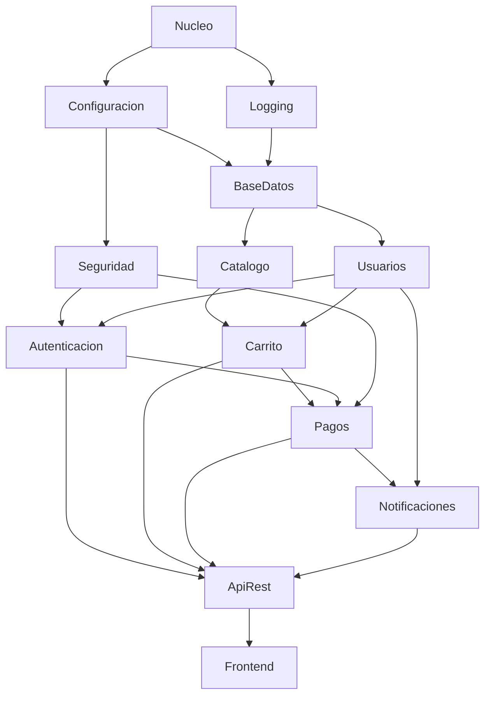

# Integración BST – Evaluación aplicada
## Reto: "¿En qué orden debo instalar los módulos?"

**Asignatura:** Estructura de Datos II · Ingeniería de Software / Sistemas · Semestre IV
**Ecosistema:** Java / GitHub
**Entregable:** grafo dirigido de dependencias + implementación DFS + resultado del recorrido/ordenamiento.

## 1. Dominio y abstracción del problema

Una tienda en línea está formada por 13 módulos de software. Cada módulo necesita que otros estén instalados antes. Si se instala en un orden incorrecto, la instalación falla. Se busca **un orden de instalación válido**.

| Elemento del problema | Elemento del grafo |
|---|---|
| Módulo de software | Vértice |
| "El módulo A debe instalarse antes que B" (B depende de A) | Arista dirigida **A → B** |
| Orden de instalación | Orden topológico del grafo |
| Dependencia circular (A necesita B y B necesita A) | Ciclo → no existe orden posible |

**Por qué un grafo dirigido:** la dependencia no es simétrica. Que `Pagos` necesite a `Seguridad` no significa que `Seguridad` necesite a `Pagos`. El sentido de la flecha es parte de la información.

## 2. Tabla de vértices (|V| = 13)

| N° | Módulo | Descripción | Grado entrada (de cuántos depende) | Grado salida (cuántos dependen de él) |
|---|---|---|---|---|
| 1 | Nucleo | librerías base y utilidades | 0 | 2 |
| 2 | Configuracion | lectura de parámetros y variables de entorno | 1 | 2 |
| 3 | Logging | registro de eventos y errores | 1 | 1 |
| 4 | BaseDatos | conexión y acceso a datos | 2 | 2 |
| 5 | Seguridad | cifrado y manejo de claves | 1 | 2 |
| 6 | Usuarios | registro y perfil de usuarios | 1 | 3 |
| 7 | Autenticacion | inicio de sesión y tokens | 2 | 2 |
| 8 | Catalogo | productos y categorías | 1 | 1 |
| 9 | Carrito | carrito de compras | 2 | 2 |
| 10 | Pagos | pasarela de pagos | 3 | 2 |
| 11 | Notificaciones | correos y avisos al cliente | 2 | 1 |
| 12 | ApiRest | servicios web que exponen el sistema | 4 | 1 |
| 13 | Frontend | interfaz web para el cliente | 1 | 0 |

## 3. Tabla de aristas (|A| = 21)

Todas las aristas son **dirigidas** y **no ponderadas** (peso = 1): solo importa el orden, no una distancia o costo. `Origen → Destino` = "Origen se instala antes que Destino".

| N° | Origen | Destino | ¿Dirigida? | ¿Ponderada? |
|---|---|---|---|---|
| 1 | Nucleo | Configuracion | Sí | No |
| 2 | Nucleo | Logging | Sí | No |
| 3 | Configuracion | BaseDatos | Sí | No |
| 4 | Configuracion | Seguridad | Sí | No |
| 5 | Logging | BaseDatos | Sí | No |
| 6 | BaseDatos | Usuarios | Sí | No |
| 7 | BaseDatos | Catalogo | Sí | No |
| 8 | Seguridad | Autenticacion | Sí | No |
| 9 | Usuarios | Autenticacion | Sí | No |
| 10 | Catalogo | Carrito | Sí | No |
| 11 | Usuarios | Carrito | Sí | No |
| 12 | Carrito | Pagos | Sí | No |
| 13 | Autenticacion | Pagos | Sí | No |
| 14 | Seguridad | Pagos | Sí | No |
| 15 | Pagos | Notificaciones | Sí | No |
| 16 | Usuarios | Notificaciones | Sí | No |
| 17 | Autenticacion | ApiRest | Sí | No |
| 18 | Carrito | ApiRest | Sí | No |
| 19 | Pagos | ApiRest | Sí | No |
| 20 | Notificaciones | ApiRest | Sí | No |
| 21 | ApiRest | Frontend | Sí | No |

## 4. Diagrama del grafo


El archivo `diagrama.mmd` contiene el mismo grafo en Mermaid. Para dibujarlo en **Draw.io**: *Organizar → Insertar → Avanzado → Mermaid* y pegar el contenido.



## 5. Clasificación formal y justificación

**G = (V, A)** con |V| = 13 y |A| = 21.

| Característica | Resultado | Justificación |
|---|---|---|
| Dirección | **Dirigido** | Las 21 aristas tienen sentido: "A se instala antes que B" no implica "B se instala antes que A". |
| Ponderación | **No ponderado** | Las aristas no llevan un valor (peso = 1); solo expresan que existe una dependencia. |
| Ciclos | **Acíclico (DAG)** | El DFS no encontró ningún arco de retroceso. Esto es indispensable: si hubiera un ciclo, no existiría un orden de instalación. |
| Conectividad | **Conexo (débilmente)** | Ignorando el sentido de las flechas, todos los módulos se alcanzan entre sí. No es fuertemente conexo, porque en un DAG nunca se puede volver al punto de partida. |
| Densidad | **Disperso** | D = 21 / (13·12) = **0.135**, menor que 0.5. Cada módulo solo depende de unos pocos. |

Módulo raíz (grado de entrada 0): `Nucleo`. Módulo final (grado de salida 0): `Frontend`.

## 6. Algoritmo: DFS y orden de instalación

### Idea

1. El **DFS** (búsqueda en profundidad) baja por una rama hasta el fondo antes de probar otra.
2. Cada vértice se marca con tres colores: **blanco** (nuevo), **gris** (en el camino actual) y **negro** (terminado).
3. Un vértice queda **negro** cuando ya se exploraron todos los módulos que dependen de él.
4. Por eso, el **postorden** (orden en que quedan negros) pone cada módulo *después* de los que lo necesitan. Al **invertirlo** se obtiene el orden de instalación.
5. Si desde un vértice gris se llega a otro gris, hay un **ciclo** de dependencias y no existe orden válido.

Complejidad: **O(|V| + |A|)**.

### Pseudocódigo

```
dfs(u):
    color[u] = GRIS;  descubrimiento[u] = ++reloj
    para cada v en sucesores(u):
        si color[v] == GRIS:  hay CICLO
        si color[v] == BLANCO: dfs(v)
    color[u] = NEGRO; finalizacion[u] = ++reloj
    postorden.agregar(u)

ordenDeInstalacion = reverso(postorden)
```

### Resultado del recorrido DFS (ejecución real)

Recorrido DFS desde `Nucleo`:

`Nucleo → Configuracion → BaseDatos → Usuarios → Autenticacion → Pagos → Notificaciones → ApiRest → Frontend → Carrito → Catalogo → Seguridad → Logging`

| Módulo | Descubrimiento | Finalización |
|---|---|---|
| Nucleo | 1 | 26 |
| Configuracion | 2 | 23 |
| BaseDatos | 3 | 20 |
| Usuarios | 4 | 17 |
| Autenticacion | 5 | 14 |
| Pagos | 6 | 13 |
| Notificaciones | 7 | 12 |
| ApiRest | 8 | 11 |
| Frontend | 9 | 10 |
| Carrito | 15 | 16 |
| Catalogo | 18 | 19 |
| Seguridad | 21 | 22 |
| Logging | 24 | 25 |

Postorden: `Frontend, ApiRest, Notificaciones, Pagos, Autenticacion, Carrito, Usuarios, Catalogo, BaseDatos, Seguridad, Configuracion, Logging, Nucleo`

### Resultado: orden de instalación (postorden invertido)

| Paso | Módulo | Necesita (ya instalados) |
|---|---|---|
| 1 | Nucleo | — |
| 2 | Logging | Nucleo |
| 3 | Configuracion | Nucleo |
| 4 | Seguridad | Configuracion |
| 5 | BaseDatos | Configuracion, Logging |
| 6 | Catalogo | BaseDatos |
| 7 | Usuarios | BaseDatos |
| 8 | Carrito | Catalogo, Usuarios |
| 9 | Autenticacion | Seguridad, Usuarios |
| 10 | Pagos | Carrito, Autenticacion, Seguridad |
| 11 | Notificaciones | Pagos, Usuarios |
| 12 | ApiRest | Autenticacion, Carrito, Pagos, Notificaciones |
| 13 | Frontend | ApiRest |

El programa verifica con `esOrdenValido(...)` que, para cada arista u → v, u aparece antes que v. **Resultado: válido.**

> Existen varios órdenes válidos (por ejemplo, `Configuracion` podría ir antes que `Logging`). El orden depende del orden en que se recorren los vecinos; lo importante es que **todos respeten las dependencias**.

## 7. Ejercicios

### Ejercicio 1 – Convertir una relación no dirigida en dirigida
Si "depende de" se modelara como no dirigida (A — B), la arista solo diría que A y B están relacionados y no se sabría cuál va primero: no habría orden de instalación. Al dirigirla (A → B) se expresa quién es la dependencia y quién el dependiente. Además, una arista no dirigida cuenta como dos arcos (A → B y B → A), lo que formaría un ciclo trivial entre cada par de módulos.

### Ejercicio 2 – Detección de un ciclo
El programa agrega una dependencia circular `Autenticacion → Seguridad` (existe `Seguridad → Autenticacion`). El DFS la detecta:

`Autenticacion → Seguridad → Autenticacion`

Con un ciclo **no existe orden de instalación**; el método `ordenDeInstalacion()` devuelve una lista vacía y hay que romper el ciclo (por ejemplo, separando en otro módulo lo que ambos comparten).

### Ejercicio 3 – ¿Qué instalo solo para tener `Pagos`?
Se hace un DFS "hacia atrás" (siguiendo las aristas al revés) para obtener las dependencias directas e indirectas, y se ordenan:

`Nucleo → Logging → Configuracion → Seguridad → BaseDatos → Catalogo → Usuarios → Carrito → Autenticacion → Pagos`

Se instalan 10 de los 13 módulos; `Notificaciones`, `ApiRest` y `Frontend` no hacen falta.

## 8. Estructura del código

| Archivo | Responsabilidad |
|---|---|
| `Vertice.java` | Módulo: nombre y descripción. |
| `Arista.java` | Dependencia: origen, destino, peso y si es dirigida (código base de la guía, con validaciones). |
| `Grafo.java` | Lista de adyacencia, DFS (recorrido y completo con tiempos y colores), orden de instalación, detección de ciclos, validación de un orden y clasificación. |
| `Main.java` | Construye el grafo y muestra tablas, DFS, orden de instalación, clasificación y ejercicios. |
| `diagrama.png` / `diagrama.mmd` | Diagrama del grafo. |

## 9. Compilar y ejecutar

```bash
javac -encoding UTF-8 -d out *.java
java -Dfile.encoding=UTF-8 -Dstdout.encoding=UTF-8 -cp out Main
```

Requiere JDK 17 o superior. Si en Windows las tildes se ven mal en la consola, ejecute antes `chcp 65001`.

## 10. Entrega en GitHub

```bash
git init
git add .
git commit -m "Integración BST: orden de instalación de módulos con DFS"
git branch -M main
git remote add origin https://github.com/<usuario>/instalacion-modulos.git
git push -u origin main
```
