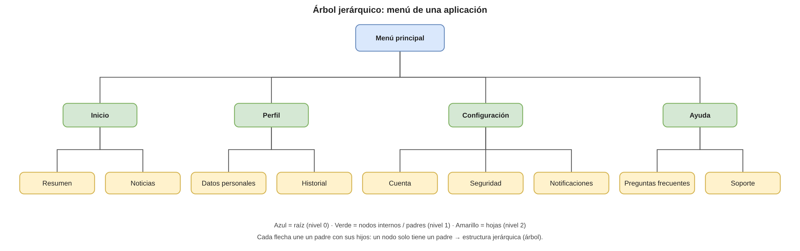

# Actividad: «De lo lineal a lo jerárquico»

**Asignatura:** Estructura de Datos II  
**Estudiante:** Lozano Vela  
**Caso elegido para el diagrama:** menú de una aplicación

## Contenido del repositorio

| Archivo | Descripción |
| --- | --- |
| `README.md` | Clasificación de los cuatro escenarios y reflexión (este archivo). |
| `EXPLICACION_1_PAGINA.md` | Explicación del diagrama (máximo 1 página). |
| `menu-aplicacion.drawio` | Diagrama editable en Draw.io. |
| `diagrama-menu-aplicacion.pdf` / `.png` | Diagrama exportado (evidencia visual). |
| `MenuAplicacion.java` | Código Java compilable que modela el menú como árbol. |

## Diagrama



## Clasificación de los cuatro escenarios

| Situación real | Tipo de estructura | ¿Por qué? |
| --- | --- | --- |
| Sistema de archivos | **Jerárquica** | Una carpeta raíz contiene subcarpetas y archivos; cada elemento depende de la carpeta que lo contiene. |
| Organigrama empresarial | **Jerárquica** | La autoridad se organiza por niveles: dirección, áreas, coordinadores y empleados. Cada cargo responde a un jefe. |
| Menú de una aplicación | **Jerárquica** | Las opciones principales se dividen en submenús y acciones, formando un árbol de navegación. |
| Árbol genealógico | **Jerárquica** | Relaciona generaciones: cada persona tiene padres y puede tener descendientes. |

> **Nota:** una lista lineal sí serviría para una fila de espera, una playlist o los pasos de una receta, donde solo importa el orden y no la dependencia entre elementos.

## ¿Por qué el menú de una aplicación?

En una lista lineal las opciones se recorren una tras otra: *Inicio, Perfil, Configuración, Ayuda*. En un menú real, cada opción puede abrir otras: *Configuración* contiene *Cuenta*, *Seguridad* y *Notificaciones*. Eso es una relación padre-hijo, y es justo lo que un árbol representa.

El árbol del diagrama tiene **14 nodos**, **9 hojas** y **altura 2** (raíz → categoría → opción).

## Cómo compilar y ejecutar

```bash
javac MenuAplicacion.java
java MenuAplicacion
```

Salida esperada (resumen):

```
=== Arbol jerarquico de un menu de aplicacion ===
- Menu principal
  - Inicio
    - Resumen
    - Noticias
  ...
Total de nodos: 14
Hojas (opciones finales): 9
Altura del arbol: 2
Ruta a 'Seguridad': Menu principal > Configuracion > Seguridad
```

## Reflexión

Las estructuras lineales sirven cuando los datos se consultan en un orden simple, como una fila, una lista de tareas o una secuencia de pasos. Pero muchos problemas reales necesitan representar dependencias entre elementos, y ahí una lista se queda corta. Un sistema de archivos, un organigrama, un menú de aplicación y un árbol genealógico comparten algo: parten de un elemento principal y se ramifican en niveles, donde cada elemento tiene un solo padre y puede tener varios hijos. Al construir el menú en Java comprobé que, si lo aplano en una lista, los datos siguen ahí pero se pierde quién pertenece a quién; en el árbol, en cambio, puedo obtener la ruta completa hasta "Seguridad". En resumen, la lista responde a "¿qué viene después?" y el árbol a "¿de qué depende esto?". Por eso elegir bien la estructura antes de programar evita recorridos confusos, búsquedas lentas y código difícil de mantener. Un árbol representa padres, hijos y niveles de forma natural, clara y fácil de ampliar con nuevas opciones.
